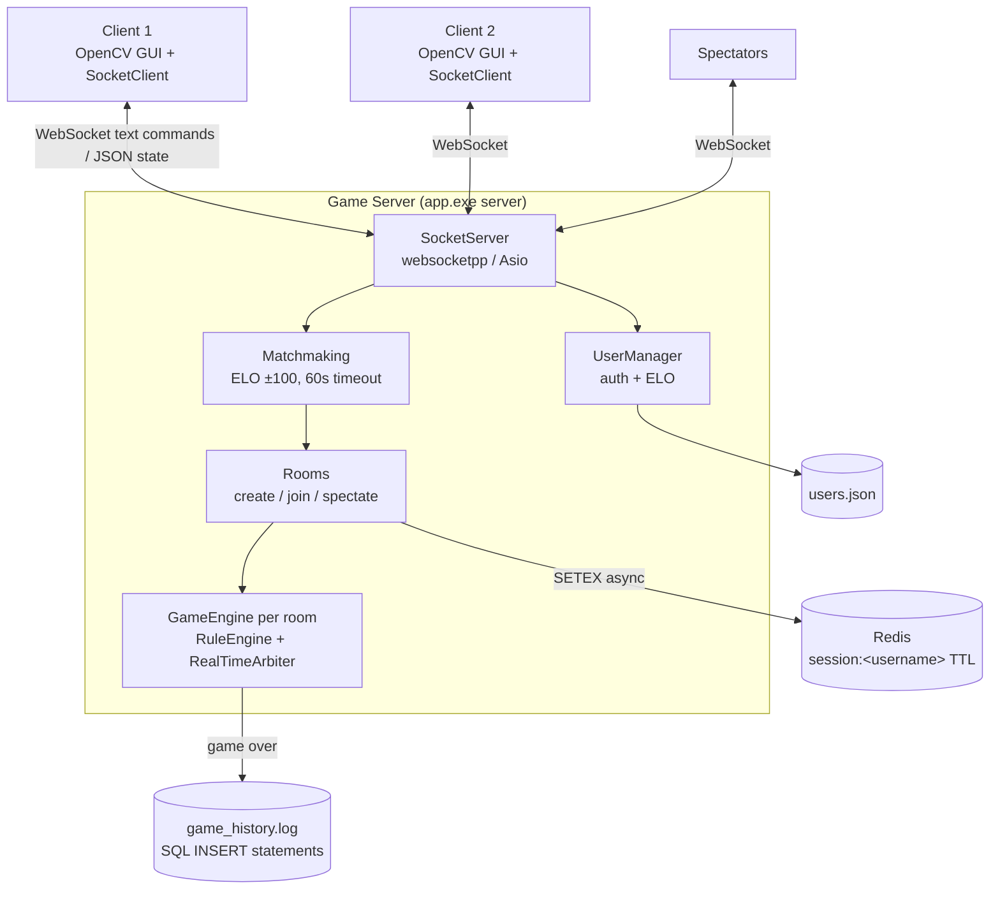

# KungFu Chess — Real-Time Multiplayer Chess Engine


KungFu Chess is a real-time chess variant with **no turns**: both players can move any of their pieces at any moment. Pieces travel across the board over time, rest (cool down) after moving, and can **jump** to dodge or intercept attacks in mid-air. The game ends when a king is captured.

The project includes an authoritative C++ game server over WebSockets, an OpenCV desktop client, ELO-based matchmaking, private rooms with spectators, reconnection handling, and Docker / Kubernetes deployment files.

---

## Gameplay

- **Real-time movement** – a selected piece moves toward its target at a speed defined in its `config.json` (`speed_m_per_sec`). Standard chess movement geometry and path blocking are enforced by `rules::PieceRules`.
- **Rest states** – after a move a piece enters `long_rest`; after a jump it enters `short_rest`. A resting piece cannot be moved until its cooldown finishes (a cooldown bar is drawn on the board).
- **Jumps** – a jumping piece is airborne for a short time. A piece that is in the air at a cell captures an enemy piece arriving there (mid-air capture).
- **Captures and scoring** – captures award material points (pawn 1 … queen 9, king 10), shown on the score panel.
- **Promotion** – a pawn that reaches the last rank becomes a queen.
- **Win condition** – capturing the opponent's king ends the game.
- **Sound effects** – move, jump, capture, illegal move, promotion, win and loss (Windows only, via WinMM).

### Controls

| Action | Input |
|---|---|
| Move a piece | Left-click a piece, then left-click the target cell (or drag and drop) |
| Jump | Right-click a piece |
| Find a match / cancel search | Click **Find Match** or press `Space` / `Enter` on the home screen |
| Create or join a room | Click the room button, type a room name or ID, then **Create** / **Join** |
| Quit | `Esc` |

---

## Run Modes

`app.exe` (built from [main.cpp](main.cpp)) runs in one of three modes:

| Mode | Command | Description |
|---|---|---|
| Local | `app.exe` | Offline game on one computer, both colors controlled with the mouse |
| Server | `app.exe server <ip> <port>` | Starts the authoritative WebSocket game server (default port `8080`; it listens on all IPv4 interfaces) |
| Client | `app.exe client <server_ip> <port> [username] [password]` | Connects to a server, logs in, and opens the full-screen game client. Missing credentials are prompted on the command line |

> In server mode the second argument is the IP slot and the third is the port, e.g. `app.exe server 0.0.0.0 8080`.

---

## Architecture



### How a game flows

1. The client connects and sends `LOGIN <user> <pass>`. `UserManager` logs in an existing user or registers a new one with ELO 1200 and replies `AUTH_OK`.
2. The client sends `FIND_MATCH`. Every server tick, players whose ELO is within ±100 are paired (`MATCH_FOUND`). A player who waits 60 seconds gets `MATCH_TIMEOUT`.
   A player can also send `CREATE_ROOM <name>` / `JOIN_ROOM <id|name>`. The second player in a room plays black, and anyone after that joins as a spectator.
3. During the game the client sends `MOVE` and `JUMP` requests. The server checks ownership and rules, applies them to the room's `GameEngine`, and broadcasts the room state as JSON (board, motions, jumps, cooldowns, scores, sounds).
4. The server game loop advances every ~30 ms. The client renders at ~60 FPS and interpolates animations between updates.
5. If a player disconnects, a 20-second reconnection countdown starts and the session is written to Redis with a 20-second TTL. A player who logs back in returns to the same room and color. If they don't return in time, the opponent wins by forfeit.
6. When the game ends, both players' ELO is updated (K = 32) in `users.json` and the result is appended to `game_history.log` as a PostgreSQL `INSERT INTO games …` statement.

---

## Project Structure

```
main.cpp                 Entry point: local / server / client modes
include/, src/
  engine/                GameEngine – applies move/jump requests and advances time
  model/                 Board, Piece, Position, GameState, BoardFactory
  rules/                 RuleEngine, PieceRules – legal move geometry and path checks
  realtime/              RealTimeArbiter, Motion – movement, jumps, cooldowns, collisions, promotion
  network/               SocketServer (matchmaking, rooms, reconnect), SocketClient
  input/                 GuiController, Controller, BoardMapper – mouse/keyboard → board actions
  view/                  Renderer + board/piece/score/overlay/opening renderers, sprite animation
  io/                    UserManager, RedisSessionStore, GameHistoryLogger, SoundPlayer,
                         BoardParser / BoardPrinter
  pubsub/                MessageBus – events for sounds, scores, move log
assets/
  board.png, Home_screen.jpg
  pieces/<XX>/states/    Sprites and config.json per piece per state
                         (idle, move, jump, short_rest, long_rest)
  sounds/                Sound effects
tests/
  unit/                  doctest unit tests (board, rules, arbiter, engine, parser, mapper...)
  load/                  load_tester.cpp – 50 concurrent client connections
thirdparty/              Asio (standalone) and websocketpp (header-only)
doctest.h                Unit-testing framework (single header)
compile_app.bat          Windows build script (MSVC)
Dockerfile               Linux build of the game server
docker-compose.yml       Game server + Redis + PostgreSQL
k8s/deployment.yaml      Kubernetes namespace, deployments, services, HPA, secret, PVC
init.sql                 PostgreSQL schema (users, games) and seed users
users.json               User store (username, password, ELO, wins, losses)
```

Piece folder names combine kind and color: `K` king, `Q` queen, `R` rook, `B` bishop, `N` knight, `P` pawn, followed by `W` (white) or `B` (black). For example, `NB` is the black knight.

Each state's `config.json` controls physics and animation:

```json
{
  "physics":  { "speed_m_per_sec": 1.5, "next_state_when_finished": "long_rest" },
  "graphics": { "frames_per_sec": 10, "is_loop": true }
}
```

---

## Building

### Windows (MSVC + OpenCV)

Requirements:
- Visual Studio 2022 (C++ desktop workload)
- OpenCV 4.12 Windows build (`opencv_world4120.lib` / `.dll`)

`compile_app.bat` runs `vcvars64.bat` and compiles all sources into `app.exe`:

```cmd
compile_app.bat
```

> The script expects OpenCV in `C:\Users\shira\Downloads\opencv\build`. If OpenCV is installed elsewhere, edit the `/I` and `/LIBPATH` paths in the script and in `.clangd`.
> `opencv_world4120.dll` must sit next to `app.exe` (it is already in the repository root).

### Linux / Docker

The `Dockerfile` builds the server with `g++ -std=c++17` on Ubuntu 22.04 (OpenCV, Boost, websocketpp from apt). The container starts with `app server 8080`.

---

## Deployment

### Docker Compose

Starts the game server, Redis 7 and PostgreSQL 16. `init.sql` runs automatically and creates the `users` and `games` tables.

```bash
docker-compose up --build
```

| Service | Container | Port |
|---|---|---|
| Game server | `kungfu_game_server` | 8080 |
| Redis | `kungfu_redis` | 6379 |
| PostgreSQL | `kungfu_postgres` | 5432 |

### Kubernetes

```bash
docker build -t kungfu-chess-server:latest .
kubectl apply -f k8s/deployment.yaml
```

Creates the `kungfu-chess` namespace with PostgreSQL (with PVC), Redis, and the game server (`LoadBalancer` service, TCP liveness/readiness probes), plus a **HorizontalPodAutoscaler** that scales from 1 to 400 replicas at 70% CPU. Before deploying, replace the placeholder password in the `db-secret` secret.

> Rooms and game state are kept in the memory of each server process. Running more than one replica would require sticky routing, so each room's players reach the same pod.

---

## Playing over LAN / Wi-Fi

**Computer 1 (server + first player):**
```cmd
app.exe server 0.0.0.0 8080
app.exe client 127.0.0.1 8080 alice 1234
```

**Computer 2 (second player):**
```cmd
app.exe client <SERVER_IP> 8080 bob 1234
```

Make sure port 8080 is allowed through the server computer's firewall.

---

## Testing

### Unit tests (doctest)

The project uses [doctest](https://github.com/doctest/doctest), a single-header testing framework (`doctest.h` in the repository root). `tests/unit/test_main.cpp` defines `DOCTEST_CONFIG_IMPLEMENT_WITH_MAIN`, and the other test files hold 28 `TEST_CASE`s:

| Test file | What it covers |
|---|---|
| `test_position.cpp` | `Position` struct |
| `test_board.cpp` | Board boundaries and piece tracking |
| `test_board_mapper.cpp` | Pixel-to-cell conversion, clicks outside the board |
| `test_board_parser.cpp` | Valid boards, inconsistent row length, invalid piece tokens |
| `test_board_printer.cpp` | Parse → print round-trip |
| `test_piece_rules.cpp` | Movement geometry of king, queen, rook, bishop, knight and pawn |
| `test_rule_engine.cpp` | Captures and blocking pieces |
| `test_controller.cpp` | A move through the controller and engine takes the expected time |
| `test_game_engine.cpp` | Movement blocking, re-moving, pawn double move and promotion, game over after a king capture |
| `test_real_time_arbiter.cpp` | Movement over time, cooldowns, concurrent moves, mid-air capture, same-color and different-color collisions, escaping pieces, no early game over |

To build them, compile the test files together with the project sources (without `main.cpp`). From a Developer Command Prompt:

```cmd
cl /EHsc /std:c++17 /DASIO_STANDALONE /D_WEBSOCKETPP_CPP11_STL_ /I. /Ithirdparty/asio /Ithirdparty/websocketpp /Iinclude /Iinclude/view /I<opencv>\include ^
   tests\unit\*.cpp src\pubsub\*.cpp src\network\*.cpp src\model\*.cpp src\rules\*.cpp src\realtime\*.cpp src\engine\*.cpp src\input\*.cpp src\io\*.cpp src\view\*.cpp ^
   /Fe:run_tests.exe /link /LIBPATH:<opencv>\x64\vc16\lib opencv_world4120.lib ws2_32.lib winmm.lib
run_tests.exe
```

### Load test

`tests/load/load_tester.cpp` opens 50 concurrent clients against `127.0.0.1:8080`. Each one logs in as `test_user_<n>` and sends `FIND_MATCH`. When it finishes, it reports how many connections succeeded and how long the run took. Build it the same way as the unit tests, with `tests\load\load_tester.cpp` instead of `tests\unit\*.cpp`, and run it while the server is up.

---

## Logs and Data

| File / Store | Content |
|---|---|
| `users.json` | Registered users, passwords, ELO, wins and losses (updated by the server) |
| `game_history.log` | One SQL `INSERT INTO games …` line per finished game, ready to import into PostgreSQL |
| `server_activity.log` | Server events: rooms, moves, disconnects, forfeits |
| `client_activity.log` | Client-side event log |
| Redis `session:<username>` | Room ID of an active player (TTL 20 s) |

Useful inspection commands when running with Docker Compose:

```bash
# Users and games tables in PostgreSQL
docker exec -it kungfu_postgres psql -U shira -d kungfu_chess -c "SELECT * FROM users;"
docker exec -it kungfu_postgres psql -U shira -d kungfu_chess -c "SELECT * FROM games;"

# Import the logged game history into PostgreSQL
docker exec -i kungfu_postgres psql -U shira -d kungfu_chess < game_history.log

# Active Redis sessions
docker exec -it kungfu_redis redis-cli KEYS "session:*"
```

---

## Concurrency Model

The project does not use a thread pool. Each long-running thread has one fixed job, and short tasks run on detached threads.

| Thread | Where | Role |
|---|---|---|
| Network thread (server) | `SocketServer::start` | Runs the websocketpp / Asio event loop: connections and incoming commands (`LOGIN`, `MOVE`, `JUMP`, …) |
| Game loop thread (server) | `SocketServer::game_loop` | Every ~30 ms: matchmaking, advancing each room's `GameEngine`, reconnect countdowns, broadcasting state |
| Network thread (client) | `SocketClient::connect_to_server` | Receives server messages and updates the local copy of the game state |
| Main thread (client) | `main.cpp` | OpenCV render and input loop (~60 FPS) |
| Detached threads | `RedisSessionStore::set_session`, `SoundPlayer::play` | One short-lived thread per call, so Redis writes and sound playback never block the game or render loop |

Shared state is protected with mutexes:

- **`SocketServer`** – `m_clients_mutex` (connected clients), `m_rooms_mutex` (rooms and their engines), `m_sounds_mutex` (pending sound events). Both the network thread and the game-loop thread use them.
- **`SocketClient`** – `state_mutex` guards the received game state. A `condition_variable` (`m_state_cv`) wakes the render loop in `wait_for_update()` as soon as a new state arrives, instead of waiting for the full frame time.
- **`UserManager`** – `m_mutex` makes reads and writes of `users.json` and ELO updates thread-safe.
- **Atomics** – `std::atomic` counters in `SoundPlayer` (unique MCI aliases) and in the load tester (success/failure counts).

`GameHistoryLogger` writes to `game_history.log` synchronously on the game-loop thread, once per finished game.

---

## Design Notes

- **Authoritative server** – clients only send requests. All rules, timing and captures run in the server's `GameEngine`, and clients render the state they receive.
- **Single Responsibility** – persistence is split into separate classes: `UserManager` (authentication and ELO), `RedisSessionStore` (non-blocking RESP `SETEX` on a detached thread), and `GameHistoryLogger` (match audit records).
- **Event bus** – `pubsub::MessageBus` keeps the game logic separate from sound and UI side effects.
- **Data-driven assets** – piece speeds, rest durations and animation rates live in per-state JSON configs, so they can be tuned without recompiling.

---

## Author

**Shira Azuelos** — Computer Science Engineering Project
